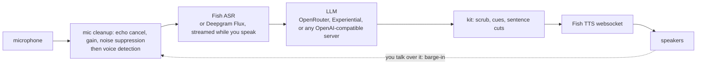

<div align="center">

<h1>🐟&nbsp;&nbsp;fish-audio-suite</h1>

<b>——&nbsp;&nbsp;&nbsp;an opinionated python toolkit for fish audio tts, asr, and live speech&nbsp;&nbsp;&nbsp;——</b>

<a href="https://github.com/kzndotsh/fish-audio-suite/actions/workflows/ci.yml"></a>
<a href="https://www.python.org/downloads/"></a>
<a href="https://docs.astral.sh/uv/"></a>
<a href="LICENSE"></a>

</div>

> [!NOTE]
> Unofficial. Not affiliated with, endorsed by, or a product of Fish Audio.
>
> **Warning**: Pre-1.0 and under active development. Anything could change at any moment and nothing is guaranteed. This notice will be left here until a stable release is published.

```text
you ▸  Hey, can you hear me?
llm ▸  [happy] Yes, I can hear you! [curious] What's on your mind today?
  ↳ first audio 1.99s · asr 0.30s · llm first token 0.75s · tts first audio 1.69s · total 5.57s
```
<sub>One turn of `fish-voice`, copied from a real run. Your numbers depend on your network, model and Fish latency setting.</sub>

## <a href="./#gh-dark-mode-only" target="_blank"></a><a href="./#gh-light-mode-only" target="_blank"></a>&nbsp;&nbsp;What Is in the Box

> •  **[`kit`](packages/kit/README.md)**: Pure text. Cue tags, markdown and thought scrubbing, sentence cuts, caption files, the Fish error types. No network, no audio, no dependencies. Reach for it when you build your own Fish client and want the text handling right.<br />
> •  **[`proxy`](packages/proxy/README.md)**: An OpenAI-compatible speech and transcription server in front of Fish, on `127.0.0.1:8849`. Reach for it with Open WebUI, or any app that already speaks the OpenAI audio API.<br />
> •  **[`voice`](packages/voice/README.md)**: One Fish websocket per turn, playback sinks, and `fish-voice`. Reach for it when you want to talk to a model, or play one Fish turn from Python.

## <a href="./#gh-dark-mode-only" target="_blank"></a><a href="./#gh-light-mode-only" target="_blank"></a>&nbsp;&nbsp;Getting Started

#### &nbsp;&nbsp;Install

> ```sh
> git clone https://github.com/kzndotsh/fish-audio-suite
> cd fish-audio-suite
> uv sync --all-packages --extra cli
> ```

#### &nbsp;&nbsp;Talk to a Model

> ```sh
> cp .env.example .env              # add FISH_API_KEY, FISH_VOICE_ID, and an LLM key
> ./packages/voice/dev.sh --smoke   # writes a WAV, no speakers or mic needed
> ./packages/voice/dev.sh           # the live loop
> ./packages/voice/dev.sh --debug   # same, with VAD, barge-in and LLM events
> ```
>
> <details>
> <summary><em>&nbsp;From Python, when your app already owns the mic and the LLM  →</em></summary>
>
> ##
>
> ```python
> from pathlib import Path
> from fish_audio_suite_voice import FileSink, FishSpeaker
>
> tts = FishSpeaker(api_key=key, voice_id=voice_id)
> result = tts.speak("Hello there.", FileSink(Path("turn.wav")))
> ```
>
> `speak` runs the websocket on a private thread, so it is safe under `asyncio.run`.
>
> </details>
>
> There is no default voice id: you bring your own. Speakers and the microphone need PortAudio, which `uv` does not install ([how](packages/voice/README.md#portaudio)).

#### &nbsp;&nbsp;Serve It to OpenAI Clients

> ```sh
> export FISH_API_KEY=...           # the proxy reads the process env, not .env
> uv run --package fish-audio-suite-proxy fish-audio-suite-proxy
> curl -s http://127.0.0.1:8849/health
> ```
>
> Point any client at `http://127.0.0.1:8849/v1`. The Fish key stays on the proxy.
>
> | Method | Path | Returns |
> | --- | --- | --- |
> | `POST` | `/v1/audio/speech` | audio bytes |
> | `POST` | `/v1/audio/transcriptions` | JSON, plain text, or an `srt` / `vtt` file |
> | `GET` | `/v1/models` | the OpenAI model list |
> | `GET` | `/health` | process up, works with no key |
>
> `tts-1` and `whisper-1` map onto Fish models. Open WebUI settings and the full field map are in the [proxy README](packages/proxy/README.md).

> [!WARNING]
> With no `FISH_PROXY_API_KEYS` the proxy accepts any client, so anyone who can reach the port spends your Fish credits. Keep the default loopback bind, or set the keys before you listen on another address.

#### &nbsp;&nbsp;Use the Text Helpers

> Clean what an LLM wrote, then cut it into pieces Fish can speak one at a time:
>
> ```python
> from fish_audio_suite_kit import normalize_cues, scrub_tts, split_tts_piece
>
> llm_text = "**Oh** really? (happy) That's [laugh] great. <think>hmm</think> Dr. Smith agrees."
>
> spoken = normalize_cues(scrub_tts(llm_text))
> # 'Oh really? [happy] That's [laughing] great. Dr. Smith agrees.'
>
> pieces, rest = [], spoken
> while rest:
>     piece, rest = split_tts_piece(rest, 40, flush_rest=True)
>     pieces.append(piece)
> # ['Oh really? ', "[happy] That's [laughing] great. ", 'Dr. Smith agrees.']
> ```
>
> `scrub_tts` strips markdown, `<think>` blocks and URLs but keeps Fish `[cue]` tags, and `normalize_cues` rewrites `(happy)` to `[happy]` and `[laugh]` to `[laughing]`. Run them in that order. A cut falls at a sentence end, and `Dr.` is not one.
>
> For a reply that is still streaming, use `FishSpeaker.speak_stream` from the voice package: it also holds back half-finished spans such as an open `**` or a URL that has not ended. The [kit README](packages/kit/README.md) lists every helper, including the ASR ones (`scrub_asr`, `is_asr_hallucination`) and caption output (`format_as_srt`).

## <a href="./#gh-dark-mode-only" target="_blank"></a><a href="./#gh-light-mode-only" target="_blank"></a>&nbsp;&nbsp;The Voice Loop



#### &nbsp;&nbsp;Streamed Replies

> With `FISH_VOICE_STREAM_TTS=1` the first sentence goes to Fish as soon as it is complete, so you hear it while the model is still writing. The flush waits for the end of the sentence, because a flush earlier makes Fish speak half a sentence as if it were finished. Without that setting the reply is spoken after the model finishes.

#### &nbsp;&nbsp;Barge-In

> You can talk over it. One mic stream stays open for the whole session, and every frame is cleaned with automatic gain, noise suppression and, while the bot speaks, echo cancellation that removes the speaker from the mic signal. A barge-in stops the reply and keeps the audio that tripped it, so your interruption becomes the next turn. The chat history records a word-aligned estimate of the part that was played, not the full reply you cut off.

<a href="docs/PERFORMANCE.md"></a>

## <a href="./#gh-dark-mode-only" target="_blank"></a><a href="./#gh-light-mode-only" target="_blank"></a>&nbsp;&nbsp;Pick Your LLM

`fish-voice` works with any OpenAI-compatible chat server. Two providers are built in, and each reads only its own key, so a provider's key is never sent to another host. `FISH_LLM_API_KEY` and `FISH_LLM_MODEL`, when set, apply to any provider.

> | `FISH_LLM_PROVIDER` | Key variable | Model variable |
> | --- | --- | --- |
> | `openrouter` (default) | `OPENROUTER_API_KEY` | `FISH_LLM_MODEL_OPENROUTER` |
> | `experiential` | `EXPLABS_API_KEY` | `FISH_LLM_MODEL_EXPERIENTIAL` |
> | anything else, with `FISH_LLM_BASE` | `OPENAI_API_KEY` | `FISH_LLM_MODEL` |
>
> Keep both in one `.env` and switch with a single line. Provider notes, reasoning effort and privacy are in the [voice README](packages/voice/README.md#llm-providers).

> [!TIP]
> Some providers keep prompts and replies. Your spoken conversation is the prompt, so read a provider's data policy before you use a free tier for anything private.

## <a href="./#gh-dark-mode-only" target="_blank"></a><a href="./#gh-light-mode-only" target="_blank"></a>&nbsp;&nbsp;Settings

The ones you touch first. Every package lists its full table.

> | Variable | Used by | Default |
> | --- | --- | --- |
> | `FISH_API_KEY` | proxy, voice | none |
> | `FISH_VOICE_ID` | voice | none, bring your own |
> | `FISH_TTS_MODEL` | proxy, voice | `s2.1-pro` |
> | `FISH_ASR_MODEL` | proxy, voice | `transcribe-1-pro` |
> | `FISH_LATENCY` | proxy, voice | `normal` |
> | `FISH_BASE` | proxy, voice | `https://api.fish.audio` |
> | `FISH_PROXY_HOST` / `FISH_PROXY_PORT` | proxy | `127.0.0.1` / `8849` |
> | `FISH_PROXY_API_KEYS` | proxy | none, any client key accepted |
> | `FISH_VOICE_STREAM_TTS` | voice | off (`1` speaks while the model writes) |
>
> `FISH_SPEED` is the default speech speed. The proxy multiplies a `speed` the client sends by it.
>
> Self-hosted [fish-speech](https://github.com/fishaudio/fish-speech) is `FISH_BASE=http://127.0.0.1:8080`. Full tables: [proxy](packages/proxy/README.md#settings), [voice](packages/voice/README.md#settings).

## <a href="./#gh-dark-mode-only" target="_blank"></a><a href="./#gh-light-mode-only" target="_blank"></a>&nbsp;&nbsp;Run It as a Service

#### &nbsp;&nbsp;Docker

> Docker runs the proxy as a non-root user:
>
> ```sh
> docker build -t fish-audio-suite-proxy:latest .
> docker run --rm -p 127.0.0.1:8849:8849 -e FISH_PROXY_HOST=0.0.0.0 \
>   --env-file /path/to/env --stop-timeout 130 fish-audio-suite-proxy:latest
> ```

#### &nbsp;&nbsp;NixOS

> ```nix
> inputs.fish-audio-suite.url = "github:kzndotsh/fish-audio-suite";
> # ...
> services.fish-audio-suite-proxy = {
>   enable = true;
>   environmentFiles = [ "/path/to/fish.env" ];  # FISH_API_KEY lives here, never in the store
> };
> ```
>
> The module runs a hardened systemd service on `127.0.0.1:8849`. Options for `host`, `port`, `autoStart`, `openFirewall`, `gracefulShutdownSeconds` and an `oci` backend are in [`nix/module.nix`](nix/module.nix). `nix run .#fish-audio-suite-voice` runs the voice CLI with PortAudio on the library path.

<a href="docs/INSTALL.md"></a>

## <a href="./#gh-dark-mode-only" target="_blank"></a><a href="./#gh-light-mode-only" target="_blank"></a>&nbsp;&nbsp;Reliability

> •  **Typed**: Type checked with basedpyright in strict mode, and each package's public API is fully typed. Fish errors are classes such as `FishAuthError` and `FishRateLimitError`, so you catch by type instead of comparing status numbers.<br />
> •  **Quiet Keys**: Keys are left out of `repr()` and `/health`, and nothing reads them at import.<br />
> •  **Safe Defaults**: A set-but-blank `FISH_PROXY_API_KEYS` stops the proxy from starting instead of silently turning auth off, and a plain-`http` remote Fish base logs a warning.<br />
> •  **Strict Tests**: Random order, warnings as errors, network sockets disabled, and CI enforces branch-coverage floors.<br />
> •  **Public API**: The names in each package's root `__all__`, plus the proxy's HTTP API. Until 1.0.0 names change freely, with no deprecation period. Details are in [CONTRIBUTING](CONTRIBUTING.md#the-public-api).

## <a href="./#gh-dark-mode-only" target="_blank"></a><a href="./#gh-light-mode-only" target="_blank"></a>&nbsp;&nbsp;Documentation

> •  **[Install](docs/INSTALL.md)**: Every way to install and run it: a clone, `uv tool`, Docker, Compose, NixOS.<br />
> •  **[Integrations](docs/INTEGRATIONS.md)**: Open WebUI, SillyTavern, RisuAI, AIRI, OpenAI SDKs, and the Python library.<br />
> •  **[Performance](docs/PERFORMANCE.md)**: Where each second of a turn goes, and the settings that make replies come sooner.<br />
> •  **[Troubleshooting](docs/TROUBLESHOOTING.md)**: Symptoms, the log lines that explain them, and the fixes.<br />
> •  **[Architecture](docs/ARCHITECTURE.md)**: How the packages fit together, with diagrams.<br />
> •  **[Glossary](docs/GLOSSARY.md)**: Barge-in, cues, flushes, AEC and the other terms the docs use.

<a href="docs/INDEX.md"></a>

## <a href="./#gh-dark-mode-only" target="_blank"></a><a href="./#gh-light-mode-only" target="_blank"></a>&nbsp;&nbsp;Contributing

> ```sh
> uv sync --all-packages --extra cli --group dev --group test
> just check        # every Python gate CI runs: lint, docstrings, types, import contracts, tests with coverage floors
> ```
>
> The same gates without `just`, and what each one checks, are in [CONTRIBUTING.md](CONTRIBUTING.md#run-the-checks).
>
> ```text
> packages/     kit, proxy, voice
> nix/          NixOS module        Dockerfile    proxy image
> scripts/      developer tools: model and voice evals, mic and VAD checks (scripts/README.md)
> ```
>
> Before you change code, read the [invariants](docs/ARCHITECTURE.md#9-invariants) for the boundaries between the packages, and [CONTRIBUTING.md](CONTRIBUTING.md) for commits and pull requests. Report vulnerabilities privately, as described in [SECURITY.md](SECURITY.md).

## <a href="./#gh-dark-mode-only" target="_blank"></a><a href="./#gh-light-mode-only" target="_blank"></a>&nbsp;&nbsp;License

This project is licensed under the [MIT License](LICENSE). Created by [@kzndotsh](https://github.com/kzndotsh).
