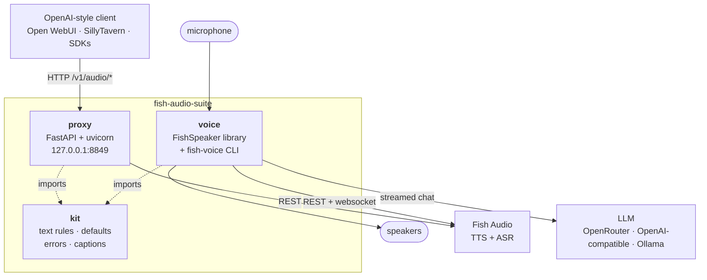
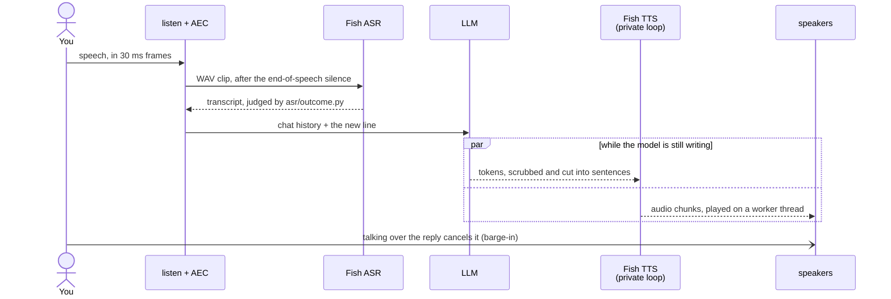
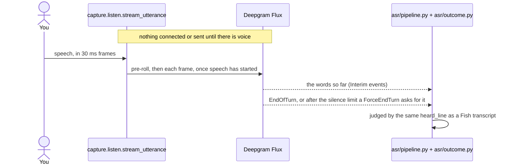
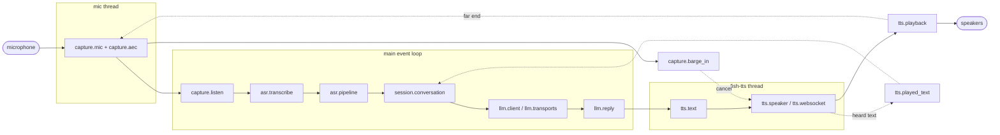

# Architecture

How fish-audio-suite is put together: the three packages, how data moves through them, and where to look when you change something. For setup and usage, see the [README](../README.md). For the rules contributors follow, see [CONTRIBUTING.md](../CONTRIBUTING.md) and the [invariants](#9-invariants) below. For latency, see [PERFORMANCE.md](PERFORMANCE.md).

> [!NOTE]
> Update this file when a module is added, renamed or split, or when a boundary between packages moves.

## 1. Project structure

A uv workspace with three Python packages. The repository root is not a package.

```
fish-audio-suite/
├── packages/
│   ├── kit/                       # pure text and types, no I/O
│   │   ├── src/fish_audio_suite_kit/    # tts, asr, types, http, config, text
│   │   └── tests/                 # incl. golden/kit_api.json (API snapshot)
│   ├── proxy/                     # OpenAI-compatible HTTP server
│   │   ├── src/fish_audio_suite_proxy/
│   │   └── tests/
│   └── voice/                     # live TTS library + fish-voice CLI
│       ├── src/fish_audio_suite_voice/  # tts, asr, capture, session, llm, config, logutil, cli
│       ├── tests/
│       └── dev.sh                 # runs fish-voice from the checkout
├── tests/                         # repo-wide: env docs, repo rules, scripts
├── scripts/                       # dev tools: vad_compare, mic_levels, evals
├── docs/                          # INDEX.md lists them all
├── nix/module.nix                 # NixOS module for the proxy service
├── flake.nix, flake.lock          # Nix packages, apps, checks
├── Dockerfile                     # proxy container image
├── .github/
│   ├── workflows/                 # ci, release, audit, dependency-submission
│   ├── actions/gates/             # the shared lint, type and test steps
│   ├── scripts/verifytypes.py     # public API type completeness
│   └── verifytypes-floors.json    # its floors, one per package
├── .agents/skills/                # agent skills: finalize, Fish API refs
├── pyproject.toml, uv.lock        # workspace, tool config, import contracts
├── justfile                       # just check, just layers, ...
├── .env.example                   # every setting, documented
├── AGENTS.md, CONTRIBUTING.md, SECURITY.md, README.md
```

Each package has `py.typed` and a curated `__init__.py`. The names in a package root's `__all__` are its public API; everything else is internal.

## 2. High-level system diagram

Two independent programs sit on one shared library. Neither program talks to the other.



### The voice turn

`fish-voice` runs one loop: listen, transcribe, answer, speak, repeat.



With `FISH_VOICE_STT=deepgram` the first two arrows change: the speech is streamed to Deepgram's Flux while it is spoken, and Flux ends the turn, so there is no clip, no fixed silence to wait out and no upload and transcribe step. `FISH_VOICE_STT=fish-realtime` runs the same path against Fish's realtime speech to text; where the text below says Flux, it holds for both unless it names a Deepgram setting.



Module by module:



| Module | Job |
| --- | --- |
| `session.duplex` | The session loop: asks the turn source for the next line, answers it, settles before the next listen, and reports every step as an event (it prints nothing) |
| `session.state` | What a turn and a reply share: `TurnInput` (the session's flags, the mic, the carried clip and the mute switch), `Chat` (the backend, the `Conversation` record, the `HistoryView` that builds each request from it, and a reply written ahead) and `DuplexContext`, which `session_context` assembles from the settings and what the session holds open (the tests build theirs with it too); `session_speaker` builds the speaker from the settings |
| `session.inputs` | Where a turn comes from: `TurnSource`, and `LiveInput`, which adds typed lines, mute and interrupt for the full-screen app |
| `session.signals` | `DuplexSession`: the quit flag and the current turn's cancel flags (`TurnSignals`); quit is sticky, so a turn bound after it starts cancelled |
| `session.events` | `EVENTS`, the bus every step reports on, the typed events, `ExitCode` and `EventQueue` for a display that runs on its own thread |
| `session.cancel` / `session.pause` | Stop flags and telling our own cancellation from an error; cancellable waits and `fish_retries`, the one Fish retry loop for TTS and ASR, which alone decides when the attempts run out |
| `capture.pcm` | The mic format: 16 kHz mono int16 in 30 ms frames (`SAMPLE_RATE`, `FRAME_MS`, `FRAME_BYTES`), and `pcm_rms`, `even_pcm`, `take_frames` and `write_mono_wav`, which writes mono int16 at any rate (`FileSink` saves TTS audio at the TTS rate) |
| `capture.portaudio` | Loads `sounddevice` when a device opens, for the mic and the speakers alike, and turns a missing PortAudio library into `PortAudioMissingError` with install hints |
| `capture.aec` | WebRTC's processor cleans every mic frame: a high-pass filter, automatic gain and noise suppression, plus AEC3 removing the bot's own voice while `tts.playback` sends it as the reference |
| `capture.mic` | The one microphone: `SessionMic` opens PortAudio on the first read and keeps it open until mute or the end of the session. A `mic` thread cleans each 30 ms frame with the echo canceller as it arrives, numbers it and keeps the last two seconds. Listen, streaming and barge-in all read it, and a reader can pick up where another stopped (`position`, `frames(since=...)`) |
| `capture.listen` | Starts and ends an utterance on the frames `capture.scoring` measures, logs what the mic heard in the post-reply cooldown (`cooldown_report`), and turns a mic that cannot open into a fatal `NoTurn` (`mic_failure`) |
| `capture.scoring` | `FrameScorer`, the one per-frame measure every gate uses: each frame's loudness, the voice detector's verdict and the adaptive floor (`capture.energy_floor`) as it stood, plus the throttled `MicLevel` meter. Each gate keeps its own rule on top |
| `capture.vad` | The `Vad` interface (`is_speech(frame, sample_rate)`), the named engines (`webrtc`, `silero`) and `package.module:factory` plugins, chosen by `FISH_VOICE_VAD_ENGINE`. Listen, barge-in and the cooldown log each open a fresh detector through `open_vad` |
| `asr.result` | What every recogniser returns (`Recognised`: the words as a `Transcript`, a `NoTurn` reason, or a `StreamFallback`), and the speech a listen can start from, each saying where it came from: a `BargeIn` clip with the level its gate admitted it at, or a `StreamFallback` |
| `asr.transcribe` | Sends the WAV clip to Fish ASR (`fish_asr`, which returns the cleaned text and, with `FISH_VOICE_HEAR_TONE`, the tone marks Fish heard as an `AsrResult`). `transcribe_clip` is the batch recogniser: it times the request, gives it the trace id the reply shares, and turns each failure into a `NoTurn` |
| `asr.turn_stream` | What a streaming recogniser declares (`Recogniser`: its settings name, log label, extra, key, how it opens, the least local silence it needs and its `problem` check), what it says about a turn (`TurnStarted`, `TurnUpdate`, `TurnEnded`, `EagerTurnEnd`, `TurnResumed`, `TurnDropped`), the `TurnStream` interface and the socket reading and closing they share (`SocketStream`) |
| `asr.deepgram` | Deepgram Flux's adapter: the address, the turn messages, a connection a test can fake, and its `Recogniser` (`DEEPGRAM`) |
| `asr.fish_realtime` | Fish's realtime speech to text (`transcribe-stream-1`): MessagePack frames in both directions, read into the same turn messages, and its `Recogniser` (`FISH_REALTIME`) |
| `asr.backends` | The registry: each streaming recogniser by its `FISH_VOICE_STT` name |
| `asr.streaming` | One turn streamed to the recogniser the registry names: the mic gate feeds frames to the connection, and the recogniser says when the turn is over |
| `llm.speculate` | A reply written ahead of time for a turn the recogniser thinks is probably over: held back, then used if the same words are confirmed (kit's `is_same_utterance`), or thrown away |
| `asr.pipeline` | Runs one listen: the streaming recogniser or a clip for Fish ASR, the carried clip it starts from, the hand-over to Fish ASR when a stream fails, and, with the turn check on, the loop that carries a turn across clips |
| `asr.outcome` | Judges every recogniser's outcome the same way (`heard_line`): quit, failures, hallucinations, fillers, a "yeah" said over the reply, stale repeats. Builds the `HeardLine` the loop acts on |
| `asr.turn_check` | The end-of-turn check on the Fish path: `OpenTurn` (the words so far across clips), the short and long silence tunes, and `Reopened`, the mic listening for a continuation while a clip is transcribed |
| `session.conversation` | `Conversation`: the record of a session, the system prompt, the pinned opening and every `Turn` (an id, the user line, the heard `Reply` and a hidden flag). Merges unanswered user lines, records what the model wrote of the heard part of a reply (`add_reply`), joining the rest of a resumed one to it, and takes edits, hides and deletes, each undoable; it converts to and from JSON. `HistoryView` builds each request from it: the last visible turns, dropped a quarter of `FISH_VOICE_HISTORY_TURNS` at a time, with the cues stripped from replies older than `FISH_VOICE_HISTORY_CUE_TURNS`, and the tone note for one request |
| `llm.client` / `llm.transports` | Streams tokens from the chat model, with retry. `llm.client` is the same for every provider except that it picks the backend; `llm.transports` holds each provider's wire format and OpenRouter's `:nitro` routing, model check and usage report. A request no retry can fix (401, 402, 404, no providers) raises `ChatUnusableError` and ends the session |
| `llm.reply` | Asks the model for the reply and speaks it. `_TokenPipe` hands tokens to the TTS thread. Starts and drops a reply written ahead of time (`start_speculation`, `drop_speculation`), built the way the reply's own request is |
| `tts.text` | The text events Fish is sent: a whole reply cut into pieces, or a streamed one held, shaped with the turn's `CueStyle` and cut as it arrives. Each piece gets the carried mood unless the model is directed |
| `tts.speaker` / `tts.turn` / `tts.websocket` | One Fish websocket per turn: text and flush out, audio chunks back. The speaker asks Fish for the format the sink declares (`audio_format`, PCM when a sink does not say) |
| `tts.audio_chain` / `tts.loudness` | `AudioChain` fades each sentence's edges (`tts.declick`) and then levels it; `LoudnessMatch` is one smoothed gain and a soft limiter that bring a reply's speech to a target level as it streams |
| `tts.playback` | Writes ~30 ms slices to the speakers on a worker thread. The sink names `FISH_VOICE_PLAYBACK` takes are in `config.playback_kind`, beside the settings |
| `capture.barge_in` | Watches the mic on its own thread while audio plays; loud voiced frames cancel the turn, and `BargeGate.clip()` is the `BargeIn` the next listen starts from. Decides how long to wait out speaker bleed: `BargeTune.aec_bleed_delay_s` when `EchoCanceller.available()`, `BargeTune.bleed_delay_s` otherwise |
| `tts.played_text` | Estimates what was heard (`spoken_so_far`), maps it back to what the model wrote (`heard_written`) for the record, and cuts the unheard rest for a resume (`unheard`) |

> [!TIP]
> Two threads matter. The LLM streams on the main asyncio loop. The Fish websocket runs on its own loop in a `fish-tts` thread, so a slow or cancelled Fish stream can never stall the LLM, and the SDK's anyio cancel scopes stay on the loop that created them. Around them, PortAudio's callback only queues raw blocks, and the `mic` thread cleans and keeps every frame. A recording runs in a worker thread that the main loop awaits, and the barge-in gate watches the mic on a thread of its own.

### The proxy request

```
POST /v1/audio/speech (OpenAI JSON)
  → body_limit.py: cap the body before any route reads it
  → server.py: client key check (FISH_PROXY_API_KEYS), a route dependency
  → speech.py read_speech: parse the body, resolve the model once, shape the
    text with its CueStyle, and decide junk
  → junk text? return local silence (audio.py), never call Fish
  → no FISH_API_KEY? 503
  → speech.py fish_tts: the Fish TTS body (JSON, or MessagePack with clips)
  → upstream.py fish_send: shared httpx client, bounded retry with Retry-After
  → stream Fish's audio back to the client as it arrives

POST /v1/audio/transcriptions (multipart or JSON)
  → transcribe.py read_asr_request: parse the upload, options and reply format
  → no FISH_API_KEY? 503
  → transcribe.py fish_asr_request: model, pro-field gating, language hint
  → upstream.py fish_send → Fish /v1/asr
  → transcribe.py transcription_reply: kit clean_transcript, phrases.py
    caption cues → json | text | verbose_json | srt | vtt
```

Every refusal on the way is raised as a `ProxyError` (`errors.py`); the app's one exception handler turns it into the OpenAI error envelope.

## 3. Core components

There is no frontend. The user-facing parts are an HTTP API (the proxy) and a terminal program (`fish-voice`).

### 3.1. fish-audio-suite-kit

- **Description:** shared, pure functions and types. It holds every rule that both programs need, so it is written once: scrubbing markdown and thoughts out of TTS text, Fish `[cue]` tags, sentence cuts and stream holds for streaming TTS, ASR cleanup and hallucination checks, whether a transcript looks like a finished turn, the tone marks Fish ASR leaves in a transcript, the Fish error shape and retry policy, settings defaults and env readers, caption formatting, and W3C trace headers.
- **Technologies:** Python 3.12+, standard library only (no runtime dependencies).
- **Deployment:** a wheel. Proxy and voice pin `fish-audio-suite-kit>=0.1,<0.2`; in the workspace the local source is used.
- **Layout:** the root holds `__init__.py`, whose `__all__` is the only supported import path, and `_version.py`. Every other module sits in one of six subpackages, keeping its name; each subpackage's `__init__.py` says what it holds and exports nothing.
- **Key modules by subpackage:**
  - `tts`: `cue_style` (`CueStyle`: how cues are shaped for one model, and the one call that shapes text), `scrub_tts`, `stream_holds`, `cuts`, `cues`, `dialogue`, `junk`, `prompt` (the default system prompt, built from the cue tables).
  - `asr`: `asr_text`, `turn`, `captions`.
  - `types`: `catalog` (the models, modes and Fish ranges, with each model's traits in one table), `defaults` (`SuiteDefaults`), `literals`, `payloads`.
  - `http`: `http_errors`, `trace_context`, `urls`.
  - `config`: `env`, and the private `_values` (number and on/off parsing).
  - `text`: `timing` (`elapsed_ms`), and the private helpers `_charsets` (every stop, closer and emphasis mark), `_single_pass` and `_speech_floor` (the one "too little speech" floor).

### 3.2. fish-audio-suite-proxy

- **Description:** an OpenAI Audio API in front of Fish Audio, so apps that speak OpenAI's TTS and speech-to-text APIs can use Fish voices without code changes. It maps model names (`tts-1`, `whisper-1`) onto Fish models, scrubs text, retries politely and streams audio back.
- **Technologies:** FastAPI, uvicorn (with uvloop and httptools), httpx, ormsgpack (reference-audio bodies), python-multipart.
- **Deployment:** `fish-audio-suite-proxy` on `127.0.0.1:8849` by default; the Docker image; or the NixOS module (`nixosModules.default`, a native systemd service or an OCI container).
- **Key modules:** `server` (app, lifespan, routes, client key and Fish key checks), `settings` (one validated settings object, read once; `/health` is derived from it), `speech` (a speech request end to end), `transcribe` (a transcription end to end), `upstream` (`fish_send` with retry, and the trace and model headers), `phrases` (Fish word segments grouped into caption cues), `request_body` (the JSON object, loose fields and base64 audio of a request), `audio` (the formats a client may ask for, and silence), `models` (model ids and aliases), `errors` (`ProxyError` and the error envelope), `body_limit`.

### 3.3. fish-audio-suite-voice

- **Description:** two things in one package.
  - A **library**: `FishSpeaker.speak(text, sink)` and `speak_stream(tokens, sink)` run one Fish TTS websocket turn on a private thread and loop, and write audio to a `PlaybackSink` (speakers, a file, stdout or mpv).
  - **`fish-voice`**: a full-duplex voice chat built on the library, with mic cleanup (echo cancellation, automatic gain, noise suppression), a voice detector, Fish ASR or Deepgram Flux, an LLM, streamed Fish TTS and barge-in.
- **Technologies:** fish-audio-sdk (websocket TTS), httpx (ASR, OpenAI-compatible SSE), numpy, loguru. The `cli` extra adds sounddevice (PortAudio), webrtcvad-wheels, pywebrtc-audio (WebRTC's audio processor) and the openrouter SDK. The `silero` extra adds pysilero-vad (`FISH_VOICE_VAD_ENGINE=silero`), the `tui` extra adds textual, and the `deepgram` and `fish-realtime` extras add websockets (Deepgram Flux, Fish realtime speech to text).
- **Deployment:** runs on the user's machine: `uv run --package fish-audio-suite-voice --extra cli fish-voice`, `./packages/voice/dev.sh`, or the flake app `fish-audio-suite-voice`.
- **Layout:** the package root holds only `__init__.py`, whose `__all__` is the public API. Every module sits in one of eight subpackages, one per domain, and each subpackage's `__init__.py` says what it holds and exports nothing.
- **Key modules by subpackage** (the import order between them is the `voice-direction` contract in `pyproject.toml`; see [the invariants](#package-boundaries)):

| Subpackage | Modules |
| --- | --- |
| `tts` (speech out) | `speaker` (`FishSpeaker`, and the one place the SDK `TTSConfig` is built), `turn` (one turn through the shared retry loop, `turn_failure` which decides what is retried, and `SdkSocket`, the Fish SDK behind the `FishSocket` seam), `websocket` (`TurnSpec`, `FishSocket`, websocket pump, `TtsResult` and the heard text), `text` (the text events for a whole or streamed reply), `tune` (`TtsTune`, the Fish TTS settings `FishSpeaker` takes as one value), `audio_chain` (fade then level, before the sink), `declick` (fades the start and end of each sentence that meets silence), `loudness` (levels the reply), `playback` (the sinks and the format each takes), `played_text` (what was heard of a reply), `ws_tap` (the Fish SDK event tap) |
| `asr` (speech recognition) | `transcribe` (the clip sent to Fish ASR, and the batch recogniser), `pipeline` (runs a listen), `outcome` (judges what was heard), `result` (what a recogniser returns, and carried clips), `turn_check` (end-of-turn check), `turn_stream` (the `Recogniser` spec, the turn messages, the `TurnStream` interface and the shared socket), `deepgram` (Flux adapter), `fish_realtime` (Fish realtime adapter), `backends` (the registry), `streaming` (one turn streamed to the chosen one) |
| `capture` (audio in) | `pcm` (the format and its helpers), `portaudio` (the device loader), `mic` (`SessionMic`), `aec` (`EchoCanceller`), `vad`, `scoring` (`FrameScorer`, the per-frame measure every gate shares), `energy_floor` (`AdaptiveFloor`), `listen`, `barge_in` (`BargeGate`) |
| `session` (the duplex loop) | `duplex` (the loop; it only emits), `state` (by who uses what: `TurnInput`, the mic side a turn source gets; `Chat`, the backend, the `Conversation`, its `HistoryView` and a reply written ahead; `DuplexContext`, what the ASR pipeline and the reply get; `CarryOver`), `inputs` (`TurnSource`, and `LiveInput` for typed lines and mute), `signals` (cancel and quit flags; quit is sticky, so a turn bound after it starts cancelled), `events` (`EVENTS`, the typed events a display follows, `ExitCode` beside `Bye`, `EventQueue`, the keys and actions), `conversation`, `cancel` (stop flags, `any_of`, telling our own cancellation from errors, and the two exception-group walks: `all_cancel_noise`, `first_real_error`), `pause` (cancellable waits and `fish_retries`, the Fish retry loop TTS and ASR share; an attempt returns `Retry` with what it gives up as, and the loop decides when no attempt is left), `latency` (`LatencySnapshot`, and the turn and session summary lines) |
| `llm` (the chat model) | `client` (`ChatBackend`, the 429 retry, the cut-off continuation, stats; it only picks the backend, and `transports` owns the OpenRouter specifics), `transports` (OpenRouter SDK or httpx SSE, each event read into one `ChatChunk`; a refused request raises `ChatHttpError`, and one no later turn could pass `ChatUnusableError`; OpenRouter's `:nitro` route, model check, provider and cost report), `reply` (answer and speak), `speculate` (a reply written ahead of time), `tune` (`LlmTune`, whose backend follows its base's host; the provider table `LLM_PROVIDERS`) |
| `config` (settings) | `settings` (`VoiceCliConfig`, the tunes plus the settings only the CLI uses; `VoiceCliConfig.prompt`, one `SystemPrompt` holding the text and whether the opening exchange is pinned, decided where the prompt is read; `sink_latency`, which alone decides `auto`), `tune` (listen, barge, turn, AEC and STT tunes, with Deepgram's own `DeepgramTune`, and the impulse constants the listen tune and `capture.listen` share), `env` (the one family of environment readers, `check_range`, and `IntSetting`, `FloatSetting` and `ChoiceSetting`, which declare a setting's variable, default and bounds once for both `from_env` and the tune's own check), `dotenv` (`load_dotenv`), `playback_kind` (the sink names) |
| `logutil` (logging) | `debug` (what every step logs through: the debug level, `debug`, `trace`, `warn`, the turn clock, and `on_terminal_line`, which lets the plain display close its reply line first), `format` (the tag, the time columns and the colours of a line), `file` (the run's file), `setup` (`configure_voice_logging`, `forward_logs` for a display's log pane, `mirror_conversation` for the file), `meta` (what a log line may show of a payload) |
| `cli` (the `fish-voice` command) | `main` (start-up: the preflight checks, then one runtime both run modes use), `console_sink` (the plain terminal display, one subscriber that `main` attaches; it owns the open reply line), `session_view` (`reduce_view` folds the state, the reply, the last turn's timings and the exit code into one immutable `SessionView`; `SpeechScale` and the drawing helpers), `tui` (the Textual app, `fish-voice --tui`, with `tui.tcss`; needs the `tui` extra), `wording` (`with_detail`, `short_model`, `transport_failure`) |

## 4. Data stores

> [!IMPORTANT]
> There is no database. Nothing is written to disk unless you ask for it: a log file per run with `FISH_VOICE_LOG_DIR`, or audio through a library `FileSink`.

- **Chat history:** a `Conversation` in memory (on the session's `Chat`) that keeps every turn, hidden ones included. Each request is built from it by `HistoryView`: the system prompt (and the default prompt's opening example) pinned, then the last visible turns up to `FISH_VOICE_HISTORY_TURNS`, dropped a quarter at a time so the cached start of the prompt survives several turns. It is lost when `fish-voice` exits.
- **Settings:** read from the environment and an optional `.env` file once at startup. Voice keeps them in frozen tunes gathered on one `VoiceCliConfig`, and the proxy in one object on `app.state.settings`.
- **Audio:** streamed through memory. A `FileSink` writes a file only when a library caller asks for one.

## 5. External integrations

| Service | Purpose | Method |
| --- | --- | --- |
| Fish Audio TTS | Speech for both programs | Proxy: REST `POST /v1/tts` (JSON, or msgpack with reference audio). Voice: the live websocket `/v1/tts/live` through `fish-audio-sdk` |
| Fish Audio ASR | Speech-to-text | REST `POST /v1/asr`, multipart. Voice can instead stream to the websocket `/v1/asr/realtime` (`transcribe-stream-1`, preview). Model `transcribe-1-pro` (`transcribe-1` retires on December 31, 2026) |
| OpenRouter | Default LLM for `fish-voice` | The `openrouter` SDK, streamed; sends `provider.sort` (latency by default) and attribution headers |
| Any OpenAI-compatible server | Alternative LLM (Experiential, a self-hosted server, Ollama) | httpx Server-Sent Events against `/chat/completions` |

Keys stay with their own host. Each named LLM provider reads only its own key variable, a known provider's key goes only to its own host, and the automatic key is sent only over https.

## 6. Deployment and infrastructure

- **Hosting:** self-hosted only, with no cloud provider required. The proxy runs wherever Python, Docker or NixOS runs. `fish-voice` runs on a desktop with a microphone and speakers.
- **Packaging:** wheels built with `uv build --all` (hatchling); a Docker image (`python:3.12-slim-bookworm`, non-root user, `/health` healthcheck); and Nix packages, apps and a NixOS module from `flake.nix`.
- **Releases:** none until 1.0.0. Versions stay at 0.1.0 and nothing is published to PyPI. `release.yml` publishes on a `v*` tag only when the repository variable `PYPI_PUBLISH` is `true`.
- **CI/CD:** GitHub Actions.
  - `ci.yml` runs the shared gates on Python 3.12, 3.13 and 3.14: ruff, pydoclint, basedpyright, type-completeness floors, the import-linter contracts, and pytest with coverage floors.
  - It also tests the lowest supported dependency versions, lints the workflows with zizmor, builds the wheels (`twine check`), runs `nix flake check`, and builds the Docker image and checks `/health`.
  - Separately, CodeQL scans the code. `audit.yml` runs pip-audit on the exported lock for pull requests that touch it, and weekly. `dependency-submission.yml` feeds GitHub's dependency graph on a push to `main` when `uv.lock` changes. Dependabot updates actions, uv, Docker and Nix with a 7-day cooldown.
- **Monitoring and logging:**
  - The proxy logs through Python logging (uvicorn access log plus two lines per speech request) and exposes `GET /health`. Request text is logged only with `FISH_PROXY_LOG_TEXT`.
  - `fish-voice` logs through loguru: `--debug` for events and `--trace` for mic heartbeats, websocket events and HTTP lines. `FISH_VOICE_LOG_DIR` (or `--log-dir`) also writes every line at the most detailed level, plus what was said, to a private file per run, whatever the screen shows: `logutil.debug.debug` and `logutil.debug.trace` write straight to it (`logutil.file`) when the screen is not showing them, and sinks for the screen skip records marked file-only. `logutil.setup.configure_voice_logging` chooses the sinks once at start-up; `logutil.format` lays out every line, on the terminal and in the file, the same way.
  - Each turn has one W3C trace id. It goes to Fish ASR and Fish TTS in the `traceparent` header, and to OpenRouter in the request's `trace` field, so a turn can be followed across services.

## 7. Security considerations

> [!CAUTION]
> The proxy spends your Fish credits for any client that can reach it. Without `FISH_PROXY_API_KEYS`, keep it on loopback.

- **Authentication:**
  - The proxy has optional client keys (`FISH_PROXY_API_KEYS`, sent as a Bearer token). A set but empty value refuses to start, rather than silently turning authentication off.
  - Without keys it accepts any client, so it binds to loopback by default.
  - It sends upstream with the operator's `FISH_API_KEY`, which is read in the lifespan, never at import.
- **Authorization:** none beyond the client key; every valid key has full access.
- **Data in transit:** https to Fish and to LLM providers. A plain `http` base on a non-loopback host only warns, because self-hosting on a LAN is legitimate.
- **Secrets:** key fields use `repr=False` and are never logged or shown in `/health`. Debug metadata strips `Authorization`, cookies and message bodies.
- **Hostile input:**
  - Request bodies and text length are capped.
  - Multipart forms are always closed.
  - Text helpers run in linear time on adversarial input, with regression tests that time them.
  - Deeply nested JSON is a 400, not a crash.
  - A transport error never reaches a client; it gets a fixed 502 or 504 message.
- **Supply chain:** pinned lockfile, pip-audit, CodeQL, zizmor, CycloneDX SBOM on release. See [SECURITY.md](../SECURITY.md) for reporting.

## 8. Development and testing

- **Setup:** `uv sync --all-packages --extra cli --group dev --group test`. Details in [CONTRIBUTING.md](../CONTRIBUTING.md).
- **All gates:** `just check` runs lint, docstrings, types, public API types, the import contracts (`just layers`) and tests with the CI coverage floors.
- **Testing:**
  - pytest with random ordering, warnings as errors, and the network blocked (`--disable-socket`; Unix sockets are allowed for asyncio).
  - Hypothesis property tests for streaming and spoken-prefix logic.
  - Doctests run in kit docstrings.
  - Timing guards are marked `perf` and can be skipped with `-m 'not perf'`.
  - Coverage floors: 89% total, with kit 94, proxy 94 and voice 85.
- **Code quality:**
  - ruff (lint and format, including docstring rules).
  - pydoclint for NumPy-style docstrings.
  - basedpyright in strict mode, plus `verifytypes.py`, which keeps public API type completeness at 100%.
  - import-linter, which checks the package and module import order in `pyproject.toml`.
  - The golden file `packages/kit/tests/golden/kit_api.json` makes every kit API change visible in review.
- **Without hardware:** tests fake the microphone, speakers, Fish and the LLM. `scripts/vad_compare.py` plays a saved recording through the barge-in gate with each voice detector, and with `--process` runs it through the app's mic cleanup first. `fish-voice --smoke` synthesizes one line with Fish into a WAV file, which checks the key, voice and network without a microphone or speakers.

## 9. Invariants

The rules most easily broken, each with its reason. A test or a lint rule enforces a rule where one exists, and the rest depend on review.

### Package boundaries

- **Three distributions only: `fish-audio-suite-kit`, `-proxy` and `-voice`.** The CLI stays in voice. There is no fourth package, no OpenTelemetry SDK (kit parses W3C trace headers itself; FastAPI 0.142+ pulls in `opentelemetry-api`, which does nothing unless a deployment installs the SDK) and no VAD package of our own (voice wraps `webrtcvad-wheels` or `pysilero-vad` behind its `Vad` interface).
- **Shared logic lives in kit.** Scrubbing, cues, sentence cuts, W3C parsing, the Fish error shape and captions are written once there. Proxy and voice must not copy those regexes, and they import kit only through its root, never a submodule or a private module. `test_repo_rules` fails on a submodule import.
- **Kit is pure text.** No network, no audio, no HTTP client, no `fishaudio`, no OpenTelemetry. `dependencies = []` keeps that honest, and a test checks that its sources import only the standard library.
- **Imports point one way.** The import-linter contracts in `pyproject.toml` (`just layers`, run by `just check` and CI) encode the layering. Kit imports neither program, and the proxy and voice never import each other (`kit-is-the-base`, `apps-are-independent`), so what both need moves to kit. In the proxy, `settings`, `audio` and `models` never import the HTTP layer (`proxy-settings-are-plain`), so reading settings needs no FastAPI. Inside voice, `voice-direction` lists the modules in rows: the CLI, then the session loop and the full-screen app, then a turn and where it comes from, capture and speech, adapters, then the turn and audio logic with no I/O of its own (what was heard, carried clips, the turn check, history, the frame scorer and voice detector, the text sent to Fish, the spoken prefix and the fade and level), and at the bottom the settings with what they and everything above share (the PCM format, the PortAudio loader, stop flags and waits, the events and the displays that follow them, logging). The rows cut across the subpackages: a subpackage groups modules by domain, and a row says what a module may import. Every module is in exactly one row: import-linter ignores a module no row lists, so `test_repo_rules` fails on one, for `kit-layers` too. Inside kit, `kit-layers` does the same across its six subpackages: the cue style, stream holds and the junk gate, then scrubbing and dialogue, cues, sentence cuts and the catalog, and the character sets at the bottom. A module may import its own row and the rows below it, never a row above. A new module goes in the lowest row it fits.

### Listening

- **One mic stream for the session, and every reader goes through it.** `SessionMic` opens the input on the first read and keeps it open between readers. Listen, streaming, the turn check's continuation, barge-in and the cooldown log all read its frames, picking up by `position` where another stopped. Opening a stream per read lost the audio between readers, such as the start of the words that tripped a barge-in. Do not open a second input stream.
- **Every frame is cleaned once, in order, as it arrives.** The `mic` thread runs `EchoCanceller.clean` on each frame whether or not anyone is reading, so AEC3 sees the mic and the speaker in step and the gain and noise estimates follow the room between replies. A reader never cleans a frame again. Every level a gate measures (`FISH_VOICE_BARGE_RMS`, the listen floor) is therefore after automatic gain, and changing `FISH_VOICE_AGC` moves them (issue #58).
- **Each listen and each barge-in watch opens a fresh detector.** A `Vad` may keep state between frames (Silero rebuffers 30 ms frames into its own chunks and keeps the last score), so `open_vad` returns a new one each time and none is shared, and its `capture.scoring.FrameScorer` asks it about a frame at most once, in order. Listen and the cooldown log ask about every frame. Barge-in asks only about frames at its level (`detect_from`), so both engines (webrtc keeps state too) hear just the loud parts of a watch; asked about every frame, they interrupted sooner on recorded speech and webrtc interrupted on typing, so the gaps stay until that is weighed on a real mic. `FISH_VOICE_VAD` sets the strictness for both. When the chosen engine cannot open, start-up stops and says why (`vad_problem`). There is no fallback to another engine.
- **With a streaming recogniser, only speech leaves the machine.** Nothing is connected or sent while the mic waits for speech to start, nor until the turn has `min_voiced_frames` voiced frames (a knock or a cough passes the start gate too, and the batch path drops them only after recording, so `asr.streaming._hold_until_voiced` does it before connecting) (Deepgram closes a connection left without audio, about 10 s on its general STT API, so connecting early would only fail). The same gate (`capture.listen._Listen`) as the batch path decides when it starts, the pre-roll and any barge-in clip go first, and every connection sets `mip_opt_out=true`. A recogniser that streamed all the time would send a room's worth of audio nobody meant to share. A test checks that nothing is sent before speech.
- **The batch path stays the default and the fallback.** `FISH_VOICE_STT` is `fish` unless set, and a turn the streaming recogniser cannot serve (an outage, not a bad key) is heard with Fish ASR: a `StreamFallback` carries the speech captured so far, each frame with the listen gate's verdict, and the mic position after it into the batch listen, which goes on from there as if it had recorded it, so the first words are kept and nothing is lost between the two readers. A bad or missing key is fatal at startup instead, because falling back would hide it.
- **A carried clip says where it came from.** A listen can start from speech it did not record: an `asr.result.BargeIn` (the clip that cut the last reply off, with the mic position after it and `BargeTune.min_rms`, the configured baseline its gate started from) or a `StreamFallback`. The listen and `asr.outcome` branch on the type, never on whether there is audio. Only a barge-in, or a fallback from a turn that began with one, was said over the reply: its voiced frames are credited (scored at its gate's level, not the listen floor), a lone "yeah" is "go on" and skipped, and it is never a stale repeat. A fallback on its own is ordinary speech: no credit, the impulse and stale-repeat rules apply, and "yeah" answers. Reading `bool(pcm)` as "barge-in" once sent a fallback down the barge-in path.
- **Mute closes every mic path.** `LiveInput.mute` releases the session's `SessionMic` at once, closing the device and dropping the two seconds it kept; the next unmuted read opens it again. `duplex_turns` builds the session's `TurnInput` with its source's mute switch (`TurnInput.muted`), and `BargeGate` takes it as `muted`: a reply that starts muted opens no mic at all, and muting mid-reply ends the watch through its stop flag (`session.cancel.any_of(cancel, muted)`) without setting the cancel flag. Typing a line or Escape still interrupts. Do not add a mic reader that ignores the switch.
- **The end-of-turn check never loses the first clip and never opens a muted mic.** With `FISH_VOICE_TURN_CHECK` the first clip ends on a short silence, and `asr.pipeline._hear_checked` keeps the mic listening (`asr.turn_check.Reopened`) while it is transcribed. Its words join the turn (`OpenTurn`) whatever happens to a continuation: nothing said, noise, a failed request. The continuation is not started when `ctx.muted()` is true, and it listens through the same stop flag as the first clip, so quit, mute and a typed line end it. A stop that is not quit drops the whole turn before `Heard` is announced, as it does for a clip. A recording it no longer needs is closed before `hear_line` returns, so the reply's barge-in watch and the next listen do not find the device busy. The Deepgram path never goes through it. The cap on continuations is `TurnTune.max_extensions`, and a joined line is never marked stale.
- **A streamed turn is dropped early when it is not speech.** A barge-in clip counts as speech in full when `_hold_until_voiced` checks for enough voice, by the same rule (`capture.listen.voice_needed`) that `listen_reject_reason` applies on the batch path, or a short interruption would be dropped as noise and the cut-off reply would go on. If Flux returns no words within `_NO_WORDS_S` (1.2 s) of streaming starting, the turn is given up on as noise, so a run of taps is not sent until the silence limit.
- **A reply written ahead of time is invisible until it is confirmed.** With `FISH_VOICE_EAGER_EOT_THRESHOLD`, the model is asked on Flux's early end-of-turn, but its tokens stay in `llm.speculate.Speculation`: no `ReplyToken`, no speech, no history entry. `llm.reply._tokens_for` replays them only if `EndOfTurn` carries the same words; any other outcome (`TurnResumed`, different words, no turn, a rejected line) cancels it. Nothing else may read a speculative reply, or a turn the user was still speaking would be answered twice. `llm.reply.start_speculation` asks with a copy of every history message, because adding the line merges it into an unanswered user line in place: sharing the message once wrote the guessed words into the session's history.
- **`DEEPGRAM_API_KEY` is read with the other settings, never at import, and `websockets` is imported when a connection opens.** The voice package imports without the `deepgram` or `fish-realtime` extra.
- **A streaming recogniser is an adapter that declares its own facts.** Each adapter module reads its protocol into the `asr.turn_stream` messages and declares a `Recogniser`: its `FISH_VOICE_STT` name, its log label, its extra, its key, how it opens from the settings, the least local silence it needs and its `problem` check. `asr.streaming`, `asr.pipeline` and `cli.main` look it up in `asr.backends.RECOGNISERS` and never name a provider, and a provider's own settings (`DeepgramTune`) are read by `config.tune` and used by its adapter, and `config.tune` also uses Deepgram's `eot_threshold` to cap the eager setting. Adding a recogniser is one adapter module, one registry entry, its name in `config.tune.STREAMING_STT_PROVIDERS` (a test checks the two agree), its extra in `pyproject.toml`, and the docs. A turn the recogniser closes as not the user's, or reports there was no turn to end, is `TurnDropped`, and its words are never answered. Fish's realtime socket carries one turn per connection here, so nothing is sent between turns or during a reply; its `agent_speaking` and backchannel messages would need a connection open while the bot talks, and are not used.

### Speaking

- **One Fish websocket per turn, on a private event loop in its own thread** (`FishSpeaker.speak`, `speak_stream`). The Fish SDK holds an anyio cancel scope inside its stream, so touching the stream from any other task raises "cancel scope in a different task". The LLM's loop must never wait on the websocket either. The pump therefore reads the SDK iterator from a single task.
- **Never `aclose()` the websocket iterator.** Stop iterating and close the client instead. Closing the iterator from another task raises the same cancel-scope error.
- **Flush after sent text, never per sentence.** An empty turn followed by a bare flush is invalid. Fish holds text until a flush or a full chunk, so one flush at the end would keep a streamed reply silent until the model finished. A streamed reply therefore flushes once at the end of the first sentence (judged on all text sent so far, so "Mr" then "." is not one) and once at the end. A flush mid-sentence makes Fish close the fragment as a finished utterance and pause.
- **History records only what was heard** (`spoken_so_far`), or nothing when no audio played. Storing the full reply would teach the next turn about words the user never heard.
- **History records what the model wrote, not what Fish was sent.** Fish gets cues the model never wrote: the default `[calm]` lead of a whole reply, and the mood `MoodCarry` puts in front of each streamed sentence. `heard_written` maps the heard part back onto the shaped reply, so the record keeps only the model's own cues. Kept, the added ones taught the model to open nearly every reply with the same cue.
- **Playback never blocks the TTS loop.** Each chunk is written on a worker thread, and cancel and tokens wake the loop instead of being polled. A blocked loop stalls text going to Fish and audio coming back.
- **`CancelledError` ends a stream quietly only when `is_own_cancel(flag)` is true.** Anything else (`asyncio.timeout`, an outer `task.cancel()`) must propagate. Reap a cancelled child with `reap(task)`, never `suppress(BaseException)`, so Ctrl+C and `SystemExit` are not swallowed. Ctrl+C must cancel the TTS turn (`session.turn`), not only the mic.
- **The reply is levelled between the fade and the sink.** `tts.audio_chain.AudioChain` runs `EdgeFade` and then `LoudnessMatch` on each PCM chunk before `sink.write`, and `SounddeviceSink` taps the far end from what it is given, so the echo canceller sees the level the speaker plays. The gain comes from the first chunk and then drifts slowly, silence is not counted, it is bounded to 12 dB and a soft limiter keeps peaks below full scale. The Fish websocket `TTSConfig` has no `normalize_loudness`, so this cannot be left to Fish. It adds no delay and is off unless `FISH_VOICE_NORMALIZE_LOUDNESS` is set.
- **Cues are shaped before Fish sees them, by one `CueStyle`.** A caller builds one style for the model (`CueStyle.for_model(model, official=..., lead=...)`: `VoiceCliConfig.cue_style` in voice, the resolved request model in the proxy) and shapes every reply with `style.shape`, which runs `scrub_tts` and then `normalize_cues` with the style's flags. A stream holds text back with `style.hold_at`, so the holds and the shaper read the same `lead`. Proxy and voice never pass `lead`, `official` or `directed` to those kit functions or call `takes_directions` themselves (`test_repo_rules` fails if they do). In `official` mode (`FISH_TTS_CUES`, default `official`) any cue Fish does not list maps to the nearest official one with `cues.official_cue`, or is dropped when none matches, because a description of a face or a voice is acted out as a sound by some voices. `cues.MoodCarry` then puts the last emotion on any sentence that starts without one, in `tts.text` for the whole and the streamed reply alike, because each piece is sent on its own. A piece that continues a sentence gets no cue. Keep both in kit, with the stem table in `cues._CUE_STEMS`; never copy it. A model that `takes_directions` (`drama-3`) gets the `directed` style: paired tags are kept, every direction is left as written and no mood is carried (`carries_mood` is False), because that model reads a direction where it is written. The model id decides this, not a setting, so the proxy and voice cannot disagree. A whole reply is shaped once: `llm.reply` shapes it, gives it a lead cue and passes it to `FishSpeaker.speak_shaped`. Only the whole reply gets the default `[calm]` lead cue and the junk check (`is_tts_junk`); a streamed reply goes to Fish as the model writes it, so it gets neither, and the cues the model writes lead it.
- **A sink's error reaches the caller; a Fish failure does not.** `speak`, `speak_shaped` and `speak_stream` re-raise what the sink raises when it opens, writes or closes (the pump wraps a write error in `tts.websocket.SinkError` so the retry loop does not report it as Fish's), and only an error raised while the turn is being cancelled is dropped as tear-down noise. A Fish failure comes back in `TtsResult`. One retry loop, `session.pause.fish_retries`, serves Fish TTS and ASR, and it alone decides when the attempts run out: a failed attempt returns `Retry` with what the failure comes to then, so a caller cannot forget the last attempt. ASR honours `Retry-After`, TTS cannot, because the SDK's `APIError` carries no headers.

### Events

- **The loop reports; displays follow.** Each step of a session is an event on `session.events.EVENTS`, and `duplex_turns` prints nothing. The plain terminal output is one subscriber (`cli.console_sink.ConsoleSink`), which `cli.main` attaches for the plain loop and leaves out for the full-screen app, so a screen of its own sees the same facts the console prints. The display owns the reply line it streams; a log line asks it to close that line first through `logutil.debug.on_terminal_line`. The exit code travels on `Bye` as a `session.events.ExitCode`. New output goes through an event, not a direct print, or a full-screen display would miss it or be corrupted by it. A test (`test_repo_rules`) fails when session code calls `print` or touches `sys.stdout` or `sys.stderr`; only the plain display, the logging modules (`logutil.debug`, `logutil.format`, `logutil.file`, `logutil.setup`), `cli.main` startup and the raw stdout audio sink may.
- **A subscriber runs on the thread that emitted the event**, which can be the event loop or an audio thread. It has to return quickly. A consumer that works at its own pace uses `EventQueue`, which drops only mic and speaker levels, interim words and log lines when it falls behind. A subscriber that raises is reported and cannot stop the session. Every event is a frozen, timestamped dataclass, exported from `session.events`, so it is safe to hand to another thread or wrap in a UI message; a test checks that for each event type, including new ones.

### The full-screen app

`fish-voice --tui` (`cli/tui.py`, `cli/tui.tcss`, the `tui` extra) runs the same session inside a Textual app. These are the rules that keep it working:

- **It only follows the event bus.** Everything it shows is an event on `session.events.EVENTS`: the conversation, state changes, the mic level, barge-in, interim words, log lines (`logutil.setup.forward_logs`, with `configure_voice_logging(to_stderr=False)`, after the chat backend has opened and checked its model on the plain terminal) and timings. `duplex_turns(source=LiveInput())` lets it take typed lines and mute; with no `ConsoleSink` attached, it draws its own screen. It folds the events into one `SessionView` (the state, the reply so far, the last turn's timings and the exit code): `reduce_view` returns a new value instead of mutating, and the status line, the timings panel and the exit code are drawn from it. The conversation, notes, log and level strips are drawn as each event arrives.
- **Events cross threads through `EventQueue`.** A subscriber runs on the thread that emitted the event, so the app collects events in an `EventQueue`. Its `wake` callback runs on the emitting thread and may only call thread-safe things such as `post_message`; everything else touches widgets from the app's own thread.
- **Keys.** A printable key goes to the focused input line, so interrupt, mute and quit are priority bindings. Ctrl+I and Ctrl+M cannot be used because a terminal sends them as Tab and Enter, and Ctrl+C is left alone because the app uses it to copy. `session.events.DEFAULT_KEYS` holds each default (Enter, Escape, F2 to mute, Ctrl+Q to quit) and a test keeps them to keys terminals reliably pass on. `session.events.available_actions(state, muted=...)` says which actions apply now (interrupt only while thinking or speaking, mute or unmute, never both) for Textual's `check_action`, and `LiveInput.stop_reply` is the interrupt.
- **Quit is the session's quit.** It calls `session.request_quit`, not only closing the screen. `duplex_turns` runs as an async worker: a cancelled worker (the app exiting) and a crash both still send `Bye` first, and a worker error exits the app (`exit_on_error=False`).
- **It needs a modern terminal.** macOS's Terminal.app is limited to 256 colors and misaligns box characters, so use iTerm2, Kitty, WezTerm or Ghostty there. `--tui` falls back to the plain loop only when stdin or stdout is not a terminal.
- **Text is plain content.** Reply and transcript text is full of square brackets (`[calm]`), which a markup parser reads as tags, so it is shown as `Content(text)` or `markup=False`, never an f-string inside markup, and cues are styled with the kit's `split_cues`. The reply text is not animated: it appears as tokens arrive.
- **Level strips share one scale.** The speaker's level is the `OutputLevel` event (one per 90 ms of audio, from the PortAudio sink only, droppable like `MicLevel`), drawn as it arrives, not folded into the view, so every block gets its bar, and shown instead of the mic while the state is speaking, because the mic then hears the speakers. The mic and the speaker use the same `cli.session_view.SpeechScale` and ease the same way (`Ballistics`, no caps), so they look alike whatever the volume. A fixed dB scale suits no mic (a quiet one leaves speech at a third of a bar), and scaling to the loudest block fails the other way (one plosive shrinks every syllable after it). `SpeechScale` measures the signal's own noise floor (a low percentile of the last six seconds) and its speech level (a high percentile of the blocks well above that floor), and spans 24 dB below the speech level. Tune it on a real mic with `scripts/mic_levels.py`, which reports the floor and speech level `SpeechScale` would take (`noise_floor_db`, `speech_level_db`).
- **It shares a process with playback, so it protects it.** Drawing holds Python's lock and can starve the playback thread until the sound card runs dry, which is heard as clicks. `cli.main.run_tui` shortens the thread switch interval, collects garbage less often (and freezes what startup built), and the playback stream asks for a bigger buffer (`FISH_VOICE_OUTPUT_LATENCY`, `high` there by default). A `tts underrun` line with `chunk_wait`, `in_python` and `write` timings says which of the causes it was. Playing audio from a separate process would remove the coupling, and is not done.
- **Packaging.** The wheel is built by Hatchling, which includes `tui.tcss` kept inside `src/fish_audio_suite_voice/cli/` (checked by building the wheel; CI builds the wheels but does not inspect their contents). The app is a flag on the existing `fish-voice` command, not a fourth distribution.
- **While changing it,** `textual run --dev` reloads the CSS on save, and `textual console` shows prints and logs, which stdout cannot while the app owns the terminal.

### Text rules

- **The user's tone is context for one request, never history and never speech.** `asr_tone` (kit) returns a few plain words from the marks Fish ASR leaves in its text, and `HistoryView.messages` appends them, in round brackets that `scrub_tts` removes, to a copy of the last user message for that request only. `DuplexContext.history`, the screen and the next request keep the plain line. The hint is never passed to the TTS cue path. The cleaned text that classification and history see is the same with the setting on or off.
- **Roleplay helpers are opt-in.** `normalize_cues(lead=True)`, `tts_hold_at(lead=True)` and `is_tts_junk(drop_narration=True)` rewrite or drop ordinary-looking English, so nothing in the default path may match it.
- **Gates drop only noise.** The letter floor is two letters with a `DEFAULT_SHORT_WORDS` allowlist ("no", "ok"), written once in `_speech_floor` for the TTS junk gate, the ASR hallucination gate and dialogue extraction, and the quit and backchannel lists take caller phrases and default to explicit goodbyes and listener noise only. A transcript that is a hallucination is dropped whole: `clean_transcript` never trims its watermark segments away and passes on the rest, because that rest ("Like and" from "Like and subscribe.") is part of the hallucination.
- **The default system prompt is voice formatting and cue use only.** No persona, scene or refusal wording: a character belongs in a character file.
- **A regex over model text is bounded or anchored.** An unbounded scan from every opener is quadratic, and this text is untrusted. Timing tests run hostile 20,000-character inputs through the scrubbers and extractors.
- **`Retry-After` is parsed in one place** (`retry_after_s`). Other packages must not write their own.

### Settings and secrets

- **Env vars are read at startup, never at import.** `FISH_API_KEY` is read in the proxy's lifespan, the CLI, or `FishSpeaker(...)`, so importing the app and `GET /health` work with no key. There is no default voice id.
- **Voice reads settings only in `config.settings.load_config()` and the `*.from_env()` tunes, through `config.env`**, once. Each read names the variable, its default and its range or choices in one call. The policy is voice's: a bad value warns and uses the default. A call that passes `quiet=True` says so where it is read, and keeps the proxy's policy instead (the shared `FISH_*` speech numbers are clamped, and `FISH_ASR_MODEL` falls back without a word). Library classes take their settings as arguments. Three exceptions are not settings: `logutil.debug.debug_level()` reads `FISH_VOICE_DEBUG` (through kit's `env_bool`, so an unknown word is off without a warning), `logutil.format` checks `NO_COLOR` for each line it colours, and `config.dotenv` writes `os.environ` when it loads a dotenv file. `test_repo_rules` fails when any other voice module reads the environment or imports `config.env`.
- **Each group of settings a library class takes is a frozen `*Tune` dataclass with `from_env()`.** `VoiceCliConfig` gathers the tunes and holds only the settings the CLI alone uses. A tune checks its values when it is built, with the same bounds `from_env` reads with (each declared once, as a `config.env` setting record whose `read` and `check` both take them), so a library caller gets what the environment gets: `ValueError` for a value the environment would refuse (`TtsTune` clamps the Fish numbers instead, as the proxy does). A run mode is not a setting: the CLI passes `full_screen` to `duplex_turns`, and `config.settings.sink_latency` turns `auto` into a buffer size there.
- **The settings tables follow the code.** `tests/test_docs_env.py` loads every setting while it records each reader call, then checks that every variable read is in the README and `.env.example` and the reverse, that both show the default the code declares, and, for voice settings, that a range they state is the code's. The proxy's readers declare no bounds (it validates or clamps after reading), so its documented ranges are not checked.
- **Key fields use `repr=False`.** Keys never reach a log or `/health`. A key goes only to its own host: each LLM provider reads only its own key variable, and the host of the final base URL decides which provider that is.

### The proxy

- **An error from the transport never reaches a client.** The client gets a fixed 502 or 504 message, and the detail goes to the log.
- **Close every multipart form** (`async with request.form()`).
- **An unset or empty `FISH_PROXY_API_KEYS` must not silently mean "no auth" after a typo.** Set but empty refuses to start.

## 10. Future considerations

Known architectural debt and likely changes, roughly in order of value:

- **Speech in the post-reply cooldown.** The cooldown keeps the bot's own echo from starting a turn, so what the mic hears in it is only logged (`listen.cooldown`, with `--debug`), never used. Feeding its last part to the next listen as pre-roll that cannot start a turn on its own would keep the first word of a quick reply.
- **A trained end-of-turn model on the Fish ASR path.** `FISH_VOICE_TURN_CHECK` judges the words with a small English heuristic (`judge_turn`). A small model (for example Pipecat's Smart Turn) that also hears the voice would judge pauses and other languages better. It is unmeasured on real speech.
- **Trimming trailing silence** from ASR clips.
- **`latency: "low"` for Fish speech.** Fish's compatible APIs default to it, but the Python SDK's `LatencyMode` accepts only `normal` and `balanced` and rejects `low` before the socket opens, so `tts.speaker._sdk_latency` coerces it (still true of fish-audio-sdk 1.4.0). Building the config without validation might reach the native realtime socket; it is untested, and Fish gives no figure for the saving.
- **EQ presets for playback.** There is no tone shaping. A high-pass around 80 Hz for rumble and bass-heavy voices (one saved clip had 39 percent of its energy below 150 Hz), and optional warmth and presence tweaks, off by default. It is a matter of taste, and a proper EQ needs SciPy filters or an FFT-based filter, since the voice package only uses NumPy now.
- **A short crossfade at joins between chunks** of continuous speech. `tts.declick` fades only edges that meet silence, so a join in the middle of speech gets nothing.
- **Linear held spans** in the stream scrubber, by remembering where a span opened across tokens.
- **Memory across sessions**, which would mean the project's first persistent store.
- **1.0.0:** PyPI trusted publishing, a container registry image, and the deprecation policy taking effect.
- **A real `stream_delay_ms` for AEC3.** The echo canceller is not told the real stream latency; the reference ring is trimmed instead. It is unverified on hardware.
- **Reusing one Fish websocket across turns** is possible in Fish's protocol, but it is deliberately not done: its setup cost is already hidden behind the LLM.

## 11. Project identification

- **Project:** fish-audio-suite (unofficial; not affiliated with Fish Audio)
- **Repository:** https://github.com/kzndotsh/fish-audio-suite
- **Maintainer:** kzndotsh
- **License:** MIT ([LICENSE](../LICENSE))
- **Last updated:** 2026-11-14

## 12. Glossary

The project's terms are defined in [GLOSSARY.md](GLOSSARY.md).
